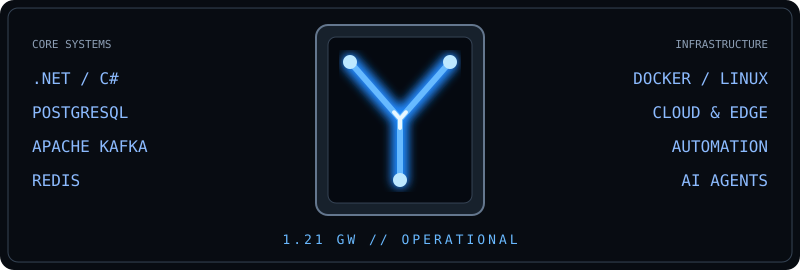

<div align="center">
  

# Mert Yomralıoğlu

**SOFTWARE ENGINEER & SYSTEMS BUILDER**

Distributed Systems · Cloud & Edge · AI Engineering

*Where we're going, we don't need roads.*

</div>


## 01 / SYSTEM IDENTIFICATION

```yaml
operator: Mert Yomralıoğlu
location: Istanbul, Türkiye
focus: Backend Engineering & Distributed Systems
mission: Engineering the Future
```

## 02 / FLUX CAPACITOR



## 03 / ENGINEERING DIRECTIVES

- Distributed systems & event-driven architecture
- Backend engineering & database systems
- Cloud & edge infrastructure
- AI agent orchestration & automation

---

<div align="center">

**OUTATIME // THE FUTURE IS WHAT YOU MAKE IT.**

</div>
